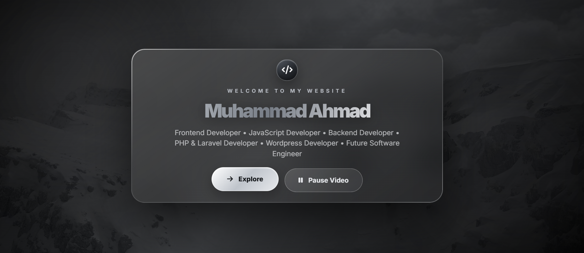

# 🎬 Video Background Website

A modern and visually engaging website featuring a cinematic full-screen video background, glassmorphism UI, and an interactive welcome screen. This project demonstrates my frontend development skills through a clean interface and interactive user experience.

## 🌟 Features

- 🎥 Full-screen background video.
- ✨ Modern glassmorphism UI design.
- 👋 Interactive welcome screen.
- 🚀 Explore button to enter the website.
- ⏯️ Video playback controls.
- 🎨 Stylish typography and visual elements.
- 🖥️ Clean and minimal user interface.

## 🛠️ Technologies Used

- **HTML5** – Website structure.
- **CSS3** – Styling, layout, and glassmorphism effects.
- **JavaScript** – Interactive functionality and controls.

## 📸 Website Preview



## 📂 Project Structure

```text
Video-Background-Website/
│
├── index.html
├── style.css
├── script.js
├── screenshot.png
└── background-video
```

## 🚀 Getting Started

1. Clone this repository:

   ```bash
   git clone https://github.com/muhammadahmad152/Video-Background-Website.git
   ```

2. Open the project folder in VS Code.

3. Run `index.html` using the Live Server extension or open it in your browser.

4. Make sure the background video file is available at the path specified in your HTML code.

## 🎯 Project Purpose

The purpose of this project is to improve my frontend development skills, explore modern UI design techniques, and gain practical experience with HTML, CSS, and JavaScript.

## 👨‍💻 Developer

**Muhammad Ahmad Khan**

Aspiring Software Engineer | Frontend Developer

- GitHub: [@muhammadahmad152](https://github.com/muhammadahmad152)

---

⭐ If you like this project, consider giving it a star!

**More projects and improvements coming soon.**
